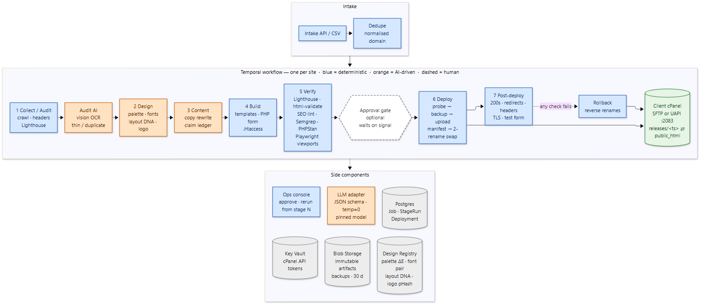
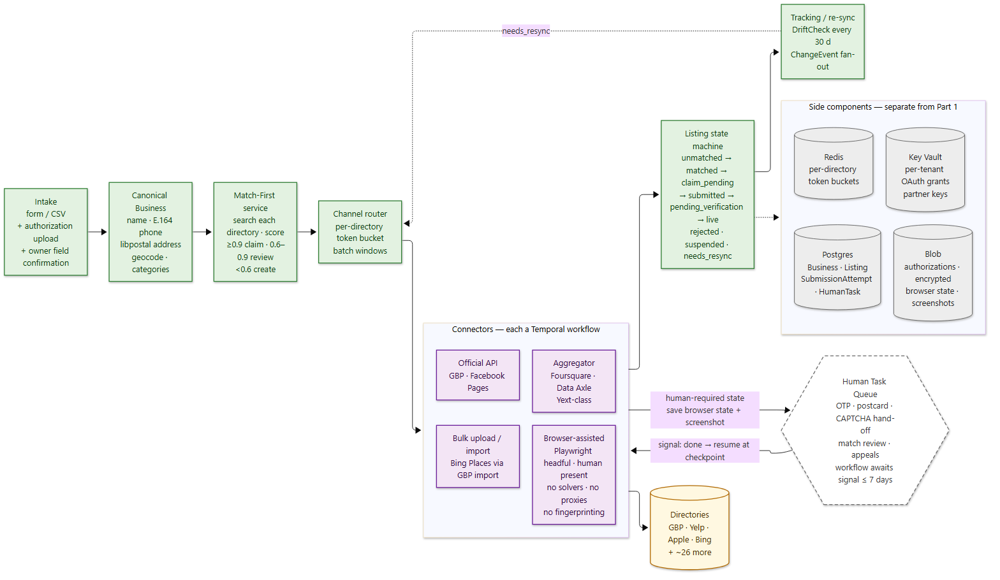
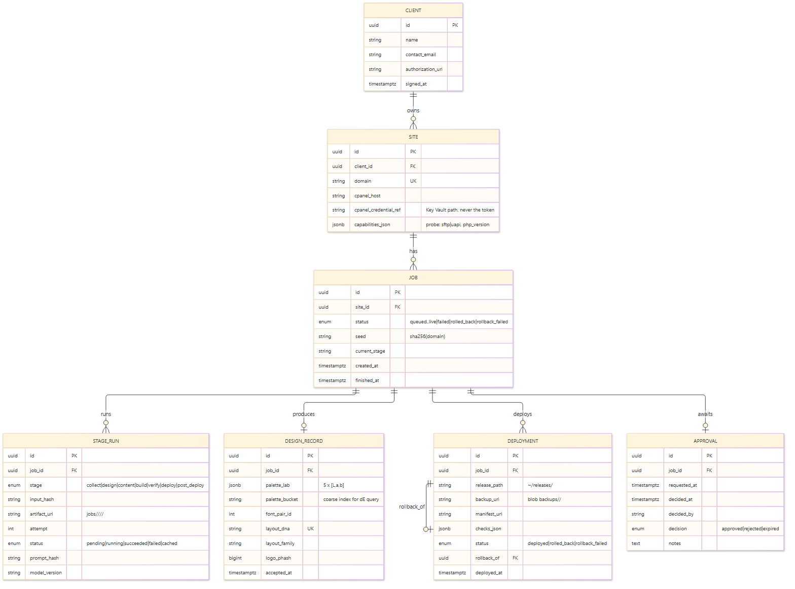
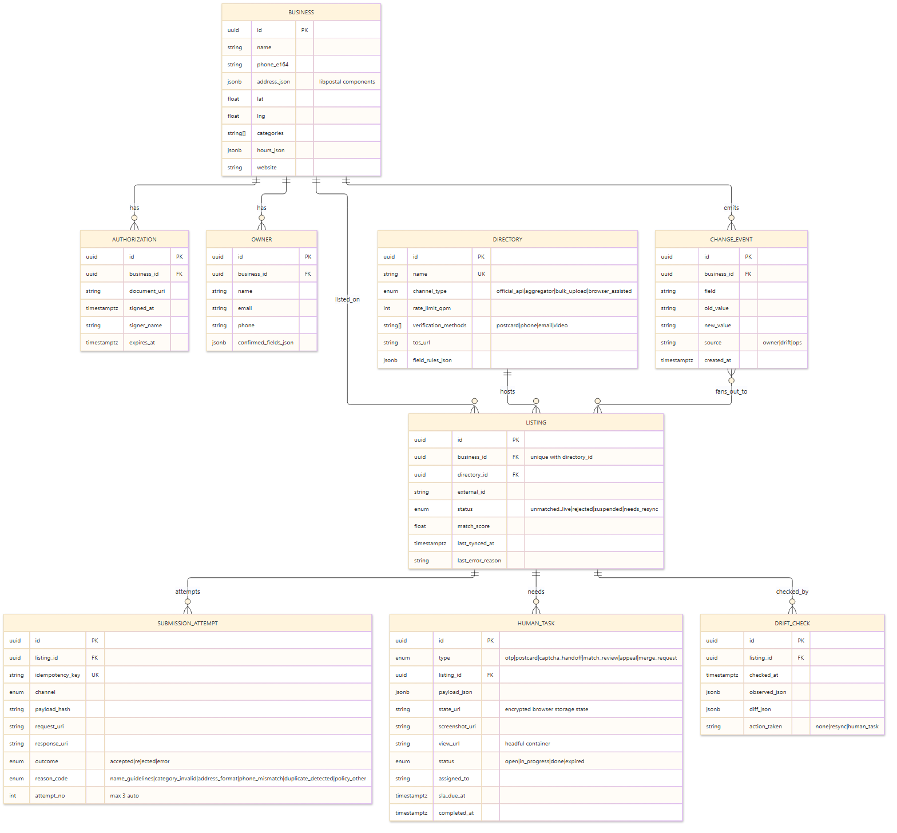

# Automated Website Redesign and Business Listings Platform — Design Document

**Author:** Saranya · **Date:** 2 November 2026 · **Status:** Proposal for review

---

## 0. Summary

Two independent systems share one operating company but no code or data:

1. **Website redesign pipeline** — ingests a client's existing site hosted on cPanel, audits it, generates a new design and copy, builds a static site plus a PHP contact form, verifies it, deploys it to the client's cPanel with an atomic swap, and rolls back automatically if post-deploy checks fail.
2. **Business listings system** — takes a canonical business record plus a signed authorization, matches it against ~30 directories, claims or creates listings through the most compliant channel available for each directory (official API, aggregator, bulk upload, or human-assisted browser session), tracks state, and re-syncs on changes.

Both run as durable Temporal workflows on Azure. The AI surface area is deliberately narrow and schema-bound; everything that must be reproducible, auditable or safe is deterministic code.

### Assumptions

| # | Assumption | Why it matters |
|---|---|---|
| A1 | Each client provides written authorization and a **cPanel API token** scoped to the account (never a password). | Shapes credential handling, deploy method, and the legal basis for acting on directories. |
| A2 | Most clients are single-location SMBs with 5–25 page sites. | Sizes the LLM budget, template library and listing fan-out. |
| A3 | cPanel hosts are heterogeneous: some expose SSH/SFTP, many only HTTPS UAPI on port 2083; PHP versions range 7.4–8.3. | Forces a capability probe before deploy and a PHP 7.4-compatible contact form. |
| A4 | We may send real-but-flagged test submissions through forms we deployed. | Enables an end-to-end post-deploy check of the contact form. |
| A5 | "Thousands" means ~5,000 businesses in year one, ramping over ~9 months. | Drives throughput, human-queue and cost numbers. |
| A6 | An LLM API (one provider, pinned model version) and an Azure subscription exist. | Stack and cost assumptions. |
| A7 | We will apply for Google Business Profile API access and Yelp/Apple partner status in week 1; approval may take weeks. | Aggregator channel is the bridge until approvals land. |
| A8 | No CAPTCHA solvers, proxies or fingerprint spoofing — ever. Human-required steps are done by a human. | Non-negotiable compliance rule for Part 2. |

---

## 1. Part 1 — Website redesign pipeline

*Blue = deterministic activities. Orange = AI-driven activities. The dashed box between Verify and Deploy is the one optional human step.*

### 1.1 Flow

Intake (API or CSV) → **Dedupe** by normalised domain → one **Temporal workflow per site** with seven activities:

| Stage | Type | What it does |
|---|---|---|
| Collect / Audit | Deterministic + AI | Playwright crawl of every reachable page, assets, headers, Lighthouse baseline; vision model transcribes text locked in images; LLM labels pages thin/duplicate on top of deterministic signals (word count, simhash). |
| Design | AI + deterministic | LLM produces a *structured* design brief (palette, font pair, layout DNA, logo SVG); deterministic Design Registry checks reject collisions. |
| Content | AI + deterministic | LLM rewrites copy page-by-page under a claim ledger; banned-phrase linter; sitemap and redirect map generated from the crawl. |
| Build | Deterministic | Jinja templates + component grammar → static HTML/CSS/JS + PHP contact form; `.htaccess` with redirects and security headers. |
| Verify | Deterministic | Lighthouse CI budgets, html-validate, custom SEO linter, Semgrep + PHPStan on the PHP form, Playwright across 4 viewports, form E2E against a local PHP container. |
| *(Approval gate)* | Human, optional | Workflow waits on a signal for up to 14 days; configurable per client. |
| Deploy | Deterministic | Capability probe → backup → upload to release dir → checksum manifest → two-rename atomic swap. |
| Post-deploy | Deterministic | HTTP 200 on home + every sitemap URL, redirects resolve, headers present, TLS valid, flagged test form submission. Any failure → automatic rollback. |

Every stage writes an immutable artifact to Blob Storage under `jobs/<job_id>/<stage>/<input_hash>/` and records a `StageRun` row in Postgres.

### 1.2 The four questions

**Q1. What is AI-driven versus deterministic, and how do we keep AI output consistent and testable?**

AI is used only where judgment or language generation is required: copy rewriting, image-text transcription (vision), the design brief (palette rationale, style direction), the logo concept (an SVG mark), and the "is this page thin or duplicate" judgment layered on deterministic signals. Everything else — crawling, dedupe, sitemap and redirect generation, templating, headers, the contact form, every verification check, and deploy — is ordinary code.

Consistency and testability come from five mechanisms:

1. **Schema-bound outputs.** Every LLM call returns JSON validated against a Pydantic schema; temperature ≈ 0; prompt hash and model version are stored on the `StageRun`. A schema failure is a retryable error, not a silent fallback.
2. **Claim ledger.** Every factual sentence in generated copy (hours, services, prices, years in business, locations) must cite a `source_span` from the crawl artifact. Sentences without a citation are dropped before build. This is the single most important control against invented facts.
3. **Banned-phrase linter.** Deterministic rejection of "guaranteed", "#1", "best in", "award-winning" (unless cited), medical/legal claims, and competitor names.
4. **Golden set.** ~20 real sites with expected outputs run in CI. A prompt or model change that moves the golden outputs beyond a tolerance fails the build.
5. **Seeded regeneration.** Design generation is seeded from `sha256(domain)`, so a rerun produces the same design unless the registry forces a reroll.

**Q2. How do we ensure uniqueness across thousands of builds?**

Design is a structured object, not a vibe, so uniqueness can be measured:

| Component | Representation | Pool size |
|---|---|---|
| Palette | 5 colours in CIELAB | Effectively continuous; ≥ 10⁴ distinguishable sets at ΔE₀₀ ≥ 12 |
| Font pair | Curated Google Fonts pairings | 60 |
| Layout DNA | `archetype × hero × nav × card × section_order` | 12 × 6 × 4 × 5 × (9 P 6 = 60,480) ≈ 8.7 × 10⁷ |
| Logo | Generated SVG mark | Unbounded; compared by perceptual hash |

Layout × fonts alone gives ≈ 5.2 × 10⁹ combinations; with palettes the space exceeds 10¹³ before logos. Collisions are therefore an accident, not a capacity problem — but they are still checked.

The **Design Registry** stores each accepted design. Before a design is accepted, four deterministic checks run:

1. Minimum CIEDE2000 distance between the proposed palette and every stored palette (indexed on a coarse LAB bucket, so one query), threshold ΔE₀₀ ≥ 12 on the primary and ≥ 8 on the average.
2. The font pair has not been used with the same layout *family* (archetype + hero).
3. The exact layout DNA string has not been used (unique index).
4. Perceptual hash (pHash, 64-bit) of the rendered logo is at Hamming distance ≥ 18 from every stored logo (BK-tree index).

A failure rejects the design and regenerates from `seed + attempt`, so reruns are reproducible and the registry check costs one indexed query per component.

**Q3. How do we deploy to cPanel safely, with credentials, backup and rollback?**

*Credentials.* The client issues a cPanel API token (A1). It is stored in Azure Key Vault under `cpanel/<site_id>`; the `Site` row holds only the Key Vault reference. The deploy worker fetches it at run time with a managed identity, keeps it in memory, and never writes it to a job file or log. The logging layer redacts any string matching a known token pattern. Tokens are rotated on job completion if the client allows.

*Method.* A capability probe runs first: try SSH/SFTP with our public key (fast, rsync-style delta upload); otherwise fall back to UAPI `Fileman` over HTTPS/2083 (upload, rename, delete, list). The probe result is cached on the `Site` row.

*Backup.* Before any write: archive `public_html` and `.htaccess` to `~/releases/prev_<ts>.tar.gz` on the host **and** copy the archive to Blob Storage (`backups/<site_id>/<ts>/`, 30-day retention). The deploy does not proceed until the Blob copy's checksum matches.

*Deploy.* Upload the build to `~/releases/<ts>/`, then compare a SHA-256 manifest of every uploaded file against the local build. Only when the manifest matches, perform two renames: `public_html → releases/prev_<ts>` then `releases/<ts> → public_html`. Downtime is the gap between two filesystem renames — milliseconds — and there is no state in which `public_html` contains a partial mix of old and new files.

*Post-deploy checks.* Homepage and every sitemap URL return 200; every entry in the redirect map resolves to its target; security headers present; TLS certificate valid for the hostname; a flagged test submission through the contact form reaches the inbox stub.

*Rollback.* Reverse the two renames. It is automatic on any failed check and on any exception after the swap. If the rollback itself fails, the job enters `rollback_failed`, an on-call alert fires with the backup URI, and the operator can restore from Blob. The previous release directory is kept for 30 days.

**Q4. How do we rerun a failed stage without restarting the job?**

Each activity is idempotent: inputs are hashed, outputs are written to `jobs/<id>/<stage>/<input_hash>/`, and the `StageRun` row records `(job, stage, input_hash, artifact_uri, attempt, status)`. Temporal retries a failed activity with exponential backoff (configurable per stage: LLM stages 5 attempts, deploy 2 attempts, never auto-retry after the swap). Because workflow history is durable, a worker crash resumes at the last completed activity rather than at the start.

An operator can **rerun from stage N** from the ops console. This sends a signal; the workflow re-executes stage N and everything downstream. Any stage whose input hash is unchanged returns the cached artifact immediately, so an upstream rerun does not recompute unaffected downstream stages, and a content-only fix does not re-crawl.

### 1.3 Numbers

| Metric | Estimate |
|---|---|
| Crawl / audit per site | 2–5 min |
| Design + content per site | 5–15 min (LLM-bound) |
| Build + verify per site | 3–5 min |
| Deploy + post-deploy checks | 2–5 min |
| **Wall clock per site** | **~20–40 min, mostly I/O wait** |
| Concurrency | 50 workflows per worker pool (Temporal; workers are cheap, LLM quota is the limit) |
| Throughput | ≈ 75–150 sites/hour → ~1,000 sites in a working day |
| LLM tokens per 15-page site | 100–200k across audit, design, content and QA passes |
| LLM cost per site | ≈ US$0.50–1.50 at a blended $5–8 per million tokens — the dominant variable cost |
| Compute per site | < US$0.10 (worker minutes + Blob) |

---

## 2. Part 2 — Business listings system

*Part 2 shares nothing with Part 1: separate database, separate workers, separate Temporal namespace. The only thing in common is the platform (Azure, Temporal, Key Vault).*

### 2.1 Flow

Intake (form or CSV, plus authorization document upload and owner confirmation of key fields) → **Canonical Business record** (normalised name, E.164 phone, libpostal-parsed address, geocode, categories mapped to a canonical taxonomy) → **Match-First service** searches each directory for an existing listing → **Channel router** picks the connector for each (business, directory) pair → one of four connector types → **Listing state machine** → **Tracking / re-sync** (drift checks and change fan-out).

A **Human Task Queue** sits beside the connectors. Every connector can create a human task (verification code, postcard, phone call, CAPTCHA hand-off, ambiguous match) and resumes when the task is completed.

### 2.2 Channel per directory

Compliance lives in this table. Each directory is accessed only through a channel its terms of service permit; "browser-assisted" always means a human is present for any step the platform intends a human to perform. Partner-programme details are as published at the time of writing and must be re-verified when applications are filed.

| Directory | Channel | Why |
|---|---|---|
| **Google Business Profile** | Official Business Profile APIs | The APIs are not open to the public; access is requested by demonstrating a legitimate business reason, and each business grants our project third-party access to manage its listing. Requests are reviewed within ~14 days; approved projects get a default quota of 300 requests per minute. Verification (postcard / phone / video) is owner-facing and becomes a human task. |
| **Yelp** | Approved listing-management partner (Yext / Synup / Chatmeter class) for writes; Yelp Fusion API for read-only matching | There is no self-serve write API. Yelp Knowledge and Listing Management partners can claim listings, update them and remove duplicates. Fallback: browser-assisted claim on Yelp for Business with human phone / email verification. |
| **Apple Business Connect** | Aggregator first; direct API if we later become an approved partner | API access for a service account requires being an administrator of a Third-Party Partner approved by Apple, and the business must delegate authority to that partner. Apple launched the API for multi-location businesses through listing-management agencies (Reputation, Rio SEO, SOCi, Uberall, Yext). |
| **Bing Places** | GBP → Bing import, then bulk upload / portal; browser-assisted for the remainder | Bing Places can import data from a verified Google Business Profile, which bypasses Bing's own verification stage. Bing has no public write API for Places (the Bing Ads Bulk API is for ad campaigns, not listings). |
| **Facebook / Instagram pages** | Official Graph API (Pages) with owner-granted permissions | Owner grants the app page management permission; address, hours and phone fields are writeable. |
| **Aggregator-fed directories** (Foursquare, Nextdoor, Yellow Pages family, TomTom/HERE map data, ~15 more) | Data aggregator (Foursquare Places, Data Axle, Neustar/Localeze) | One submission fans out to many directories under the aggregator's existing agreements. Slower (days–weeks) but fully compliant and cheap. |
| **Long tail** (industry portals, chambers of commerce, local directories) | Bulk upload where offered; otherwise browser-assisted with a human present | Volume is low enough that a human-in-the-loop session per listing is acceptable. |

### 2.3 The four questions

**Q1. How do we achieve throughput within each platform's rules?**

- **Per-directory token bucket** in Redis, configured *below* each platform's documented quota (GBP: 240 QPM against a 300 QPM limit). Every connector acquires a token before any call; the bucket is shared across all workers.
- **One API project per channel, per-tenant OAuth.** Each business's owner authorises our project once; calls are made with that business's grant, so no business can exhaust another's quota and we never share credentials across tenants.
- **Batch windows.** Submissions are spread over the working day (e.g. 5,000 GBP updates scheduled across 6 hours) rather than burst, which keeps us well under quotas and makes rate-limit responses rare instead of routine.
- **Backoff on 429 / quota errors** with jitter; the token bucket's refill rate is reduced automatically for 15 minutes after any 429.

*The math.* 5,000 businesses × ~30 directories = **150,000 listing tasks** in year one.

| Channel | Share of tasks | Clearing time |
|---|---|---|
| Official API (GBP, Facebook) | ~15% (≈ 22k) | GBP at 240 QPM with 3–5 calls per listing ≈ 50–80 listings/min → all 5,000 GBP listings in **~1–2 hours** of API time. |
| Aggregator | ~55% (≈ 80k) | One bulk file per day; propagation 3–14 days but zero per-listing effort. |
| Bulk upload / import | ~10% (≈ 15k) | Hours per batch. |
| Browser-assisted | ~20% (≈ 30k) | **Human-bound.** |

The real bottleneck is people, not APIs. If ~10 of the 30 directories per business need a human moment averaging 2 minutes (verification code entry, postcard confirmation, CAPTCHA hand-off, ambiguous match review), that is 5,000 × 10 × 2 = **100,000 minutes ≈ 1,700 person-hours**, or roughly one full-time person for a year, or four people for a quarter. The design goal is therefore to push every directory possible onto API or aggregator channels and reserve browser-assisted work for the long tail. This is the honest trade-off: compliance costs human time, and the system's job is to make each human minute count by preparing everything a person needs before they open the task.

**Q2. How do we pause for human steps (CAPTCHA, OTP, postcard) and resume?**

The browser-assisted connector is a Temporal workflow whose Playwright activity runs in a headful container.

1. The activity detects a human-required state: a CAPTCHA iframe, an OTP input, "we sent a code" copy, a "check your email for a claim link", or a postcard-pending status.
2. It saves the encrypted Playwright storage state (cookies, local storage) to Blob, takes a screenshot, records a **step pointer** (connector step name + URL + form state), and creates a `HumanTask` with everything the person needs: screenshot, instructions, the business's authorization document, and a view URL for the live browser.
3. The workflow then **awaits a signal** with a long timeout — 15 minutes for OTP, 72 hours for email links, **7 days for postcards**. No process is running while it waits; Temporal persists the wait.
4. For CAPTCHAs specifically, the human takes over the live browser session through the headful container's view URL. **The bot never touches the challenge**; the person solves it and clicks Done in the task UI, which sends the signal.
5. On signal, the activity restores the saved storage state, navigates back to the checkpoint and continues. If the timeout expires the task is marked `expired`, the listing goes to `pending_verification` with a reason, and a reminder task is created.

**No-circumvention rule, verbatim: no CAPTCHA solvers, no proxies, no fingerprinting.** Any connector change that would violate this fails code review.

**Q3. How do we prevent duplicate listings?**

- **Match-first, always.** Before any create: normalise name, phone (E.164) and address (libpostal); geocode; search each directory (GBP location search, Yelp Fusion business match, aggregator lookup, portal search for the rest); score candidates on name similarity, phone exact match, address distance (< 50 m) and category overlap.
- **Thresholds.** Score ≥ 0.9 → auto-claim or update the existing listing. 0.6–0.9 → human review task showing both records side by side. < 0.6 → create.
- **Database guarantees.** A unique constraint on `(business_id, directory_id)` in the `Listing` table plus an **idempotency key** (`sha256(business_id, directory_id, payload_hash)`) on every `SubmissionAttempt` make a second create impossible at our end even if two workers race.
- **Directory-side duplicates** found later (by drift checks or owner report) open a `merge_request` human task; where the directory supports it (GBP, Yelp via partner) the merge is done through the channel, otherwise the person requests it in the portal.

**Q4. How do we handle rejections and suspensions?**

- Every rejection is mapped to a **reason taxonomy**: `name_guidelines`, `category_invalid`, `address_format`, `phone_mismatch`, `duplicate_detected`, `policy_other`.
- Each reason has an **automatic fixer** where the fix is mechanical (strip marketing terms from the name, map to the nearest valid category, reformat the address with libpostal, use the owner-confirmed phone). The fixed payload is resubmitted with a new idempotency key.
- **Cap of three** automatic resubmits per listing; the fourth attempt is a human task with the full history attached.
- **Suspensions** open an `appeal` task with the signed authorization document and the business's confirmation attached. If the suspension reason is business-level (e.g. the business is judged ineligible) rather than listing-level, all other pending submissions for that business are **frozen** until the appeal resolves, so we do not spread a problem across directories.
- All of this is visible on the listing timeline in the ops console, so a human picking up a task sees what the system already tried.

### 2.4 Numbers

| Metric | Estimate |
|---|---|
| Listing tasks year one | 150,000 (5,000 businesses × 30 directories) |
| API-channel clearing time | Hours per batch (GBP: ~1–2 h for 5,000 listings at 240 QPM) |
| Aggregator propagation | 3–14 days, near-zero marginal effort |
| Human-assisted tasks | ~50,000 moments × 2 min ≈ 1,700 person-hours |
| Human-task SLA targets | OTP 15 min, email link 24 h, postcard 7 days, match review 4 h |
| Drift check cadence | Every 30 days per live listing; immediately after any `ChangeEvent` |
| Direct cost per business | Aggregator fee (≈ US$5–15/month) + API calls (negligible) + human time |

---

## 3. Data models

### 3.1 Part 1 — redesign pipeline

| Entity | Key fields |
|---|---|
| **Client** | id, name, contact, authorization_uri, signed_at |
| **Site** | id, client_id, domain, cpanel_host, cpanel_credential_ref (Key Vault path), capabilities_json (probe result) |
| **Job** | id, site_id, status, seed, current_stage, created_at, finished_at |
| **StageRun** | id, job_id, stage, input_hash, artifact_uri, attempt, status, prompt_hash, model_version, started_at, finished_at — unique on (job_id, stage, input_hash, attempt) |
| **DesignRecord** | id, job_id, palette_lab (5 × 3 floats), palette_bucket, font_pair_id, layout_dna, layout_family, logo_phash, accepted_at — unique on layout_dna |
| **Deployment** | id, job_id, release_path, backup_uri, manifest_uri, checks_json, status, rollback_of (self-reference), deployed_at |
| **Approval** | id, job_id, requested_at, decided_at, decided_by, decision, notes |

**Job status enum:** `queued → collecting → designing → writing → building → verifying → awaiting_approval → deploying → live` with terminal/exception states `failed`, `rolled_back`, `rollback_failed`.

**StageRun status enum:** `pending → running → succeeded | failed | cached`.

### 3.2 Part 2 — business listings

| Entity | Key fields |
|---|---|
| **Business** | id, canonical name, phone_e164, address_json (libpostal components), lat/lng, categories, hours_json, website |
| **Authorization** | id, business_id, document_uri, signed_at, signer_name, expires_at |
| **Owner** | id, business_id, name, email, phone, confirmed_fields_json |
| **Directory** | id, name, channel_type, rate_limit_qpm, verification_methods[], tos_url, field_rules_json |
| **Listing** | id, business_id, directory_id, external_id, status, match_score, last_synced_at, last_error_reason — unique on (business_id, directory_id) |
| **SubmissionAttempt** | id, listing_id, idempotency_key (unique), channel, payload_hash, request_uri, response_uri, outcome, reason_code, attempt_no, created_at |
| **HumanTask** | id, type, listing_id, payload_json, state_uri (encrypted browser state), screenshot_uri, view_url, status, assigned_to, sla_due_at, completed_at |
| **ChangeEvent** | id, business_id, field, old_value, new_value, source, created_at → fans out to one re-sync per live listing |
| **DriftCheck** | id, listing_id, checked_at, observed_json, diff_json, action_taken |

**Listing status enum:** `unmatched → matched → claim_pending → submitted → pending_verification → live`, with side states `rejected`, `suspended`, `needs_resync` (re-enters at `submitted`).

**HumanTask status enum:** `open → in_progress → done | expired`. **Directory.channel_type enum:** `official_api | aggregator | bulk_upload | browser_assisted`.

---

## 4. Delivery plan and risks

### 4.1 Phases

| Phase | Duration | Part 1 — redesign pipeline | Part 2 — listings |
|---|---|---|---|
| **1. Pilot** | 2–3 weeks | End-to-end pipeline on 10 pilot sites; manual approval on every deploy; deploy-with-rollback hardened first (it is the safety-critical path). | Canonical record + match-first; GBP via API and Bing via GBP import; file GBP, Yelp and Apple partner applications in week 1; manual approval on every submission. |
| **2. Scale-up** | 4–6 weeks | 500 sites; full verify suite in CI; golden-set regression; design registry live; approval gate optional per client. | Aggregator connector; human task queue with SLAs; browser-assisted connector with pause/resume; rejection taxonomy and fixers. |
| **3. Scale** | ongoing | Thousands of sites; cost tuning (prompt caching, smaller model for audit pass); capacity-based autoscaling of workers. | Thousands of businesses; drift detection and change fan-out; Apple/Yelp direct channels as approvals land; staffing model for the human queue. |

### 4.2 Top risks

| Risk | Mitigation |
|---|---|
| LLM invents facts in copy | Claim ledger (uncited sentences dropped) + banned-phrase linter + golden-set regression in CI. |
| cPanel heterogeneity (no SSH, old PHP, disk quotas) | Capability probe before deploy; UAPI fallback; PHP 7.4-compatible form; quota check before upload. |
| Design collisions across thousands of builds | Design Registry with CIEDE2000, font/layout-family and pHash distance checks; seeded regeneration. |
| GBP / Apple / Yelp partner approval delays | Start applications in week 1; aggregator as the bridge; nothing in the pipeline depends on a channel that is not yet approved. |
| Human queue becomes the bottleneck | Channel mix pushes ≥ 80% of tasks off humans; per-task-type SLAs; everything a person needs is pre-attached to the task; staffing forecast from queue metrics. |
| Credential leak | Key Vault with managed identity; scoped API tokens, not passwords; log redaction; rotation after each job; tokens never in artifacts. |
| Rollback failure after a bad deploy | Previous release kept on host and in Blob for 30 days; `rollback_failed` state pages on-call; manual restore runbook. |
| Platform policy changes (quota, ToS) | Channel config in the `Directory` table, not code; per-directory kill switch; quarterly ToS review. |

---

## 5. Stack and trade-offs

| Concern | Choice | Alternative considered |
|---|---|---|
| Language | Python for all workers; PHP 7.4-compatible contact form shipped to the client host | Node for workers (fine, but Playwright/Lighthouse tooling and the team's experience favour Python). |
| Orchestration | **Temporal** (Python SDK): per-activity retries, replay from durable history, workflows that wait on a signal for days with no running process, rerun-from-stage via signals. | **Celery + Postgres state machine**: simpler to operate, but checkpointing, long human waits and partial reruns would be hand-built — exactly the hardest requirements here. |
| Cloud | **Azure**: Container Apps (or AKS) for workers, Key Vault for secrets, Blob Storage for artifacts and backups, Azure Database for PostgreSQL, Redis for rate-limit buckets, Service Bus for intake. | AWS / GCP equivalents are interchangeable (ECS/Cloud Run, Secrets Manager, S3/GCS, RDS/Cloud SQL). |
| LLM | One provider behind a thin adapter; structured JSON outputs; pinned model version recorded on every StageRun. | Multi-provider routing — not worth the evaluation burden at this scale. |
| Browser automation | Playwright: headless for checks, headful in a container (with a view URL) for human hand-offs. | Selenium — weaker session-state and viewport tooling. |
| Verification | Lighthouse CI, html-validate, custom SEO rule linter, Semgrep + PHPStan for the PHP form, Playwright for viewports and form E2E. | — |
| Address / phone normalisation | libpostal, phonenumbers (E.164) | Vendor geocoding API only — fine for geocode, weak for parsing. |

**Why Temporal over a simpler queue, in one sentence:** the two hardest requirements — rerun one failed stage without restarting the job, and pause at a human step for days then resume — are Temporal's native primitives (activity retries + durable history, and signals), whereas a queue makes us build and test both ourselves.
